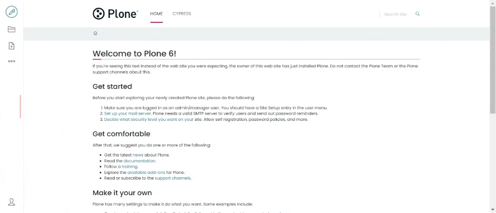

# @eeacms/volto-controlpanel

[](https://github.com/eea/volto-controlpanel/releases)
[](https://ci.eionet.europa.eu/view/Github/job/volto-addons/job/volto-controlpanel/job/master/display/redirect)
[](https://sonarqube.eea.europa.eu/dashboard?id=volto-controlpanel)

[Volto](https://github.com/plone/volto) add-on that enhance Version Overview information in Control Panel:
* Frontend Version
  * When it was updated and from which version
  * Link to Frontend changelog
  * Volto version and the list of all installed Volto add-ons
* Backend Version
  * When it was updated and from which version
  * Link to Backend changelog
  * List of all Python eggs installed on Backend

## Requirements

This addon requires a server-side package to be installed.
* [eea.api.controlpanel](https://github.com/eea/eea.api.controlpanel?)

## Features



## Environment Variables

You can control the information displayed in Volto Control Panel via the following environment variables:

* `RAZZLE_CHANGELOG_PREFIX` - Default: `https://github.com/eea` - Used to compose the links to CHANGELOG
* `RAZZLE_CHANGELOG_SUFFIX` - Default: `releases` - Used to compose the links to CHANGELOG
* `RAZZLE_FRONTEND_VERSION` - Default: `''` - Frontend version
* `RAZZLE_FRONTEND_NAME`    - Default: `''` - Used to compose the links to CHANGELOG
* `RAZZLE_BACKEND_VERSION`  - Default: `''` - Backend version
* `RAZZLE_BACKEND_NAME`     - Default: `plone-backend` - Used to compose the backend link to CHANGELOG

## Upgrade Guide

### Upgrading to 3.x

> This version requires `Volto 18` or `Volto 19` and Node.js 22.

The add-on keeps the same API and the same settings keys, so upgrading from 2.x on Volto 18 needs no code changes. The release adds Volto 19 support and moves the repository to the Volto 19 layout, where the published package lives in `packages/volto-controlpanel`.

#### Breaking changes

- **Node.js 22 or newer is required** (`engines.node >= 22`), 2.x declared no engine.
- **React 18 is required.** The package declares `react` and `react-dom` as `^18.2.0` peers, 2.x declared no peers.
- **The package no longer ships the Jest setup.** `jest-addon.config.js` and `jest.setup.js` were removed in favour of Vitest, so a Volto 18 project that still runs the Jest harness has to keep its own copy.

### Upgrading to 2.x

> This version requires `Volto >= 17` and adds full support for `Volto 18+` (Cookieplone). It removes the hard-coded dependency on the project's root `package.json` and drops the `node-fetch` server-side dependency in favor of Node's built-in `fetch`.

#### Breaking changes

- **Removed the project `package.json` import.** Previous versions used a relative import (`../../../../package.json`) to read the project's `name` and `version` as fallback values for `frontendVersion` and `frontendName`. This path only worked when the addon was installed under `src/addons/` (Volto 17 layout) and crashed at build time in Cookieplone's `packages/` layout. The import has been removed — `RAZZLE_FRONTEND_VERSION` and `RAZZLE_FRONTEND_NAME` environment variables (or `config.settings.frontendVersion` / `config.settings.frontendName`) are now the only way to set these values. If neither is provided, they default to empty strings.
- **Removed `node-fetch` dependency.** The server-side `updateSystemInfo` call now uses Node's native `fetch` (available in Node 18+). If `fetch` is not available, the call is silently skipped.

#### Migration

1. Ensure `RAZZLE_FRONTEND_VERSION` and `RAZZLE_FRONTEND_NAME` environment variables are set in your deployment (Docker, Rancher, etc.). These were already the recommended way to configure these values — this change only removes the automatic fallback from `package.json`.
2. No code changes are required in your project if you were already setting these environment variables.

## Installation

1. Make sure you have a [Plone backend](https://plone.org/download) up-and-running at http://localhost:8080/Plone

   ```Bash
   docker compose up backend
   ```

1. Start Volto frontend

* If you already have a volto project, just update `package.json`:

   ```JSON
   "dependencies": {
       "@eeacms/volto-controlpanel": "*"
   }
   ```

   and `volto.config.js`:

   ```JavaScript
   const addons = ['@eeacms/volto-controlpanel'];
   ```

* If not, create one with Cookieplone, as recommended by the official Plone documentation for Volto 18+:

   ```
   uvx cookieplone project
   cd project-title
   ```

1. Install or update dependencies, then start the project:

   ```
   make install
   ```

   For a Cookieplone project, start the backend and frontend in separate terminals:

   ```
   make backend-start
   make frontend-start
   ```

1. Go to http://localhost:3000

1. Happy editing!

## License

See [LICENSE.md](LICENSE.md) for details.

## Funding

[European Environment Agency (EU)](http://eea.europa.eu)
